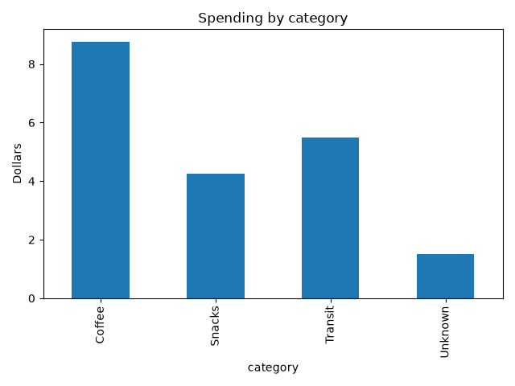

# pandas-spending-analysis

A beginner pandas project that walks a small spending dataset through a full analysis workflow.

## What it does
- Loads a CSV with `pd.read_csv`
- Profiles the data with `info()` and `isna().sum()`
- Cleans it: converts text dates to datetime, fills missing amounts with 0 and missing categories with "Unknown"
- Totals spending by category with `groupby` (the pandas version of SQL GROUP BY)
- Charts the totals with matplotlib

## Result
Total spend: $20.00. Coffee was the largest category at $8.75.

## Run it
pip install pandas matplotlib
python lesson.py
